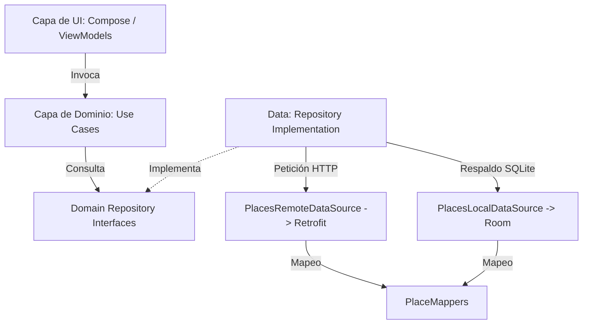

# Arquitectura, Patrones de Diseño y Descripción del Proyecto Alrededor

Documentación técnica completa del proyecto Android **Alrededor**, detallando la responsabilidad de cada archivo, las arquitecturas implementadas, los patrones de diseño aplicados, el código fuente completo de las dos pantallas y el funcionamiento del flujo de datos, API remota y base de datos local.

---

## 1. Descripción de Archivos por Capa

### 🟢 Capa de Aplicación y Configuración
* [AlrededorApp.kt](file:///C:/Users/coron/AndroidStudioProjects/Alrededor/app/src/main/java/com/eduardo/alrededor/AlrededorApp.kt): Clase principal de aplicación (`GuiaApp`) anotada con `@HiltAndroidApp`. Configura Hilt e implementa `ImageLoaderFactory` de Coil con soporte para vectores SVG y el cliente HTTP de la app (con cabecera `User-Agent`).
* [MainActivity.kt](file:///C:/Users/coron/AndroidStudioProjects/Alrededor/app/src/main/java/com/eduardo/alrededor/MainActivity.kt): Actividad principal anotada con `@AndroidEntryPoint`. Configura la Splash Screen del sistema, habilita diseño borde a borde y carga la interfaz de Compose con `GuiaNavHost()`.
* [AndroidManifest.xml](file:///C:/Users/coron/AndroidStudioProjects/Alrededor/app/src/main/AndroidManifest.xml): Manifiesto del sistema. Declara permisos de red y ubicación (`INTERNET`, `ACCESS_FINE_LOCATION`, `ACCESS_COARSE_LOCATION`), la clase de aplicación `.GuiaApp` y la orientación vertical de la pantalla.

---

### 🔵 Capa de Dominio (`domain/`)

#### Modelos (`domain/model/`)
* [GeoPoint.kt](file:///C:/Users/coron/AndroidStudioProjects/Alrededor/app/src/main/java/com/eduardo/alrededor/domain/model/GeoPoint.kt): Objeto de valor inmutable que representa coordenadas geográficas (latitud y longitud).
* [Place.kt](file:///C:/Users/coron/AndroidStudioProjects/Alrededor/app/src/main/java/com/eduardo/alrededor/domain/model/Place.kt): Modelo principal de dominio para un lugar de interés (ID, título, ubicación, descripción, miniatura, URL del artículo y bandera de relevancia).
* [PlacesResult.kt](file:///C:/Users/coron/AndroidStudioProjects/Alrededor/app/src/main/java/com/eduardo/alrededor/domain/model/PlacesResult.kt): Envoltorio con la lista de lugares devueltos y la bandera `isFromCache` (indica si proviene de SQLite por falta de red).
* [NearbyPlace.kt](file:///C:/Users/coron/AndroidStudioProjects/Alrededor/app/src/main/java/com/eduardo/alrededor/domain/model/NearbyPlace.kt): Asocia un `Place` con la distancia calculada en metros y el rumbo inicial en grados desde la posición del usuario.
* [RelativeDirection.kt](file:///C:/Users/coron/AndroidStudioProjects/Alrededor/app/src/main/java/com/eduardo/alrededor/domain/model/RelativeDirection.kt): Enum (`FRONT`, `RIGHT`, `BEHIND`, `LEFT`) con lógica para traducir ángulos relativos a direcciones cardinales orientativas.
* [ExploreDefaults.kt](file:///C:/Users/coron/AndroidStudioProjects/Alrededor/app/src/main/java/com/eduardo/alrededor/domain/model/ExploreDefaults.kt): Constantes de reglas de negocio (radio de 10 km, umbral de movimiento de 300 m, límites de elementos).
* [LocationGrant.kt](file:///C:/Users/coron/AndroidStudioProjects/Alrededor/app/src/main/java/com/eduardo/alrededor/domain/model/LocationGrant.kt): Enum de dominio (`PRECISE`, `APPROXIMATE`, `NONE`) que representa la concesión del sistema.
* [LocationPermissionState.kt](file:///C:/Users/coron/AndroidStudioProjects/Alrededor/app/src/main/java/com/eduardo/alrededor/domain/model/LocationPermissionState.kt): Interfaz sellada con los estados de permiso (`NotRequested`, `Denied`, `PermanentlyDenied`, `GrantedApproximate`, `GrantedPrecise`).

#### Repositorios - Contratos (`domain/repository/`)
* [PlacesRepository.kt](file:///C:/Users/coron/AndroidStudioProjects/Alrededor/app/src/main/java/com/eduardo/alrededor/domain/repository/PlacesRepository.kt): Contrato para obtener lugares cercanos.
* [LocationRepository.kt](file:///C:/Users/coron/AndroidStudioProjects/Alrededor/app/src/main/java/com/eduardo/alrededor/domain/repository/LocationRepository.kt): Contrato para transmitir posiciones GPS en tiempo real (`Flow<GeoPoint>`).
* [OrientationRepository.kt](file:///C:/Users/coron/AndroidStudioProjects/Alrededor/app/src/main/java/com/eduardo/alrededor/domain/repository/OrientationRepository.kt): Contrato para transmitir el azimut del sensor brújula (`Flow<Float>`).
* [LocationPermissionRepository.kt](file:///C:/Users/coron/AndroidStudioProjects/Alrededor/app/src/main/java/com/eduardo/alrededor/domain/repository/LocationPermissionRepository.kt): Contrato para consultar el estado del permiso de ubicación.

#### Casos de Uso (`domain/usecase/`)
* [GetNearbyPlacesUseCase.kt](file:///C:/Users/coron/AndroidStudioProjects/Alrededor/app/src/main/java/com/eduardo/alrededor/domain/usecase/GetNearbyPlacesUseCase.kt): Caso de uso para obtener lugares cercanos coordinando con el repositorio.
* [ShouldRefetchPlacesUseCase.kt](file:///C:/Users/coron/AndroidStudioProjects/Alrededor/app/src/main/java/com/eduardo/alrededor/domain/usecase/ShouldRefetchPlacesUseCase.kt): Regla pura que evalúa si el usuario se desplazó más de 300 m o si la actualización fue forzada.
* [ComputeNearbyPlacesUseCase.kt](file:///C:/Users/coron/AndroidStudioProjects/Alrededor/app/src/main/java/com/eduardo/alrededor/domain/usecase/ComputeNearbyPlacesUseCase.kt): Calcula distancia y rumbo, filtra lugares irrelevantes, ordena por cercanía y limita la lista.
* [ResolveLocationPermissionStateUseCase.kt](file:///C:/Users/coron/AndroidStudioProjects/Alrededor/app/src/main/java/com/eduardo/alrededor/domain/usecase/ResolveLocationPermissionStateUseCase.kt): Determina el estado del permiso combinando respuesta del sistema e historial guardado.
* [MarkLocationPermissionRequestedUseCase.kt](file:///C:/Users/coron/AndroidStudioProjects/Alrededor/app/src/main/java/com/eduardo/alrededor/domain/usecase/MarkLocationPermissionRequestedUseCase.kt): Persiste el registro de solicitud de permisos.

#### Utilidades (`domain/util/`)
* [GeoUtils.kt](file:///C:/Users/coron/AndroidStudioProjects/Alrededor/app/src/main/java/com/eduardo/alrededor/domain/util/GeoUtils.kt): Fórmula de Haversine para distancia geográfica y cálculo de rumbo inicial en grados.
* [RelevanceFilter.kt](file:///C:/Users/coron/AndroidStudioProjects/Alrededor/app/src/main/java/com/eduardo/alrededor/domain/util/RelevanceFilter.kt): Filtra elementos irrelevantes (calles, paradas de autobús, avenidas) según palabras clave en la descripción.

---

### 🟡 Capa de Datos (`data/`)

#### Remota (`data/remote/`)
* [WikipediaApi.kt](file:///C:/Users/coron/AndroidStudioProjects/Alrededor/app/src/main/java/com/eduardo/alrededor/data/remote/WikipediaApi.kt): Interfaz Retrofit para la API Geosearch de MediaWiki y definiciones de DTOs (`PageDto`, `WikipediaResponseDto`, etc.).
* [PlacesRemoteDataSource.kt](file:///C:/Users/coron/AndroidStudioProjects/Alrededor/app/src/main/java/com/eduardo/alrededor/data/remote/PlacesRemoteDataSource.kt): Ejecuta consultas remotas en Wikipedia y procesa respuestas y errores de API.

#### Local (`data/local/`)
* [PlaceEntity.kt](file:///C:/Users/coron/AndroidStudioProjects/Alrededor/app/src/main/java/com/eduardo/alrededor/data/local/PlaceEntity.kt): Entidad Room que mapea la tabla SQLite `lugares`.
* [PlaceDao.kt](file:///C:/Users/coron/AndroidStudioProjects/Alrededor/app/src/main/java/com/eduardo/alrededor/data/local/PlaceDao.kt): Objeto de acceso a datos Room para `lugares` con operaciones `@Upsert` y búsquedas espaciales.
* [SummaryEntity.kt](file:///C:/Users/coron/AndroidStudioProjects/Alrededor/app/src/main/java/com/eduardo/alrededor/data/local/SummaryEntity.kt): Entidad Room que mapea la tabla SQLite `resumenes` con clave foránea en cascada hacia `lugares.id_pagina`.
* [SummaryDao.kt](file:///C:/Users/coron/AndroidStudioProjects/Alrededor/app/src/main/java/com/eduardo/alrededor/data/local/SummaryDao.kt): Objeto de acceso a datos Room para la tabla `resumenes`.
* [BookmarkEntity.kt](file:///C:/Users/coron/AndroidStudioProjects/Alrededor/app/src/main/java/com/eduardo/alrededor/data/local/BookmarkEntity.kt): Entidad Room que mapea la tabla SQLite `favoritos` con clave foránea en cascada hacia `lugares.id_pagina`.
* [BookmarkDao.kt](file:///C:/Users/coron/AndroidStudioProjects/Alrededor/app/src/main/java/com/eduardo/alrededor/data/local/BookmarkDao.kt): Objeto de acceso a datos Room para la tabla `favoritos`.
* [AppDatabase.kt](file:///C:/Users/coron/AndroidStudioProjects/Alrededor/app/src/main/java/com/eduardo/alrededor/data/local/AppDatabase.kt): Base de datos Room SQLite (`guia.db`) que registra las entidades `PlaceEntity`, `SummaryEntity` y `BookmarkEntity`.
* [PlacesLocalDataSource.kt](file:///C:/Users/coron/AndroidStudioProjects/Alrededor/app/src/main/java/com/eduardo/alrededor/data/local/PlacesLocalDataSource.kt): Fuente de datos SQLite local para guardar y recuperar lugares en segundo plano.
* [PermissionPreferencesDataSource.kt](file:///C:/Users/coron/AndroidStudioProjects/Alrededor/app/src/main/java/com/eduardo/alrededor/data/local/PermissionPreferencesDataSource.kt): Almacenamiento en DataStore Preferences para la bandera `ubicacion_ya_solicitada`.

#### Mappers e Implementación (`data/mapper/` & `data/repository/`)
* [PlaceMappers.kt](file:///C:/Users/coron/AndroidStudioProjects/Alrededor/app/src/main/java/com/eduardo/alrededor/data/mapper/PlaceMappers.kt): Mapeo bidireccional entre DTOs, entidades de BD y modelos de dominio.
* [PlacesRepositoryImpl.kt](file:///C:/Users/coron/AndroidStudioProjects/Alrededor/app/src/main/java/com/eduardo/alrededor/data/repository/PlacesRepositoryImpl.kt): Repositorio **Offline-First**. Intenta red; ante `IOException`/`HttpException` recurre a la base de datos Room.
* [FusedLocationRepository.kt](file:///C:/Users/coron/AndroidStudioProjects/Alrededor/app/src/main/java/com/eduardo/alrededor/data/repository/FusedLocationRepository.kt): Transmite coordenadas del GPS mediante `FusedLocationProviderClient` encapsulado en un `callbackFlow`.
* [SensorOrientationRepository.kt](file:///C:/Users/coron/AndroidStudioProjects/Alrededor/app/src/main/java/com/eduardo/alrededor/data/repository/SensorOrientationRepository.kt): Transmite el azimut de la brújula usando `SensorManager` (`TYPE_ROTATION_VECTOR`) con suavizado exponencial.
* [LocationPermissionRepositoryImpl.kt](file:///C:/Users/coron/AndroidStudioProjects/Alrededor/app/src/main/java/com/eduardo/alrededor/data/repository/LocationPermissionRepositoryImpl.kt): Implementa el repositorio de permisos coordinando sistema y DataStore.

---

### 🟣 Inyección de Dependencias (`di/`)
* [DataModule.kt](file:///C:/Users/coron/AndroidStudioProjects/Alrededor/app/src/main/java/com/eduardo/alrededor/di/DataModule.kt): Módulo Hilt que vincula contratos de repositorio con sus implementaciones (`@Binds`) y provee `DataStore`.
* [NetworkModule.kt](file:///C:/Users/coron/AndroidStudioProjects/Alrededor/app/src/main/java/com/eduardo/alrededor/di/NetworkModule.kt): Provee `Json`, `OkHttpClient` con cabecera `User-Agent` e instancia de `WikipediaApi`.
* [DatabaseModule.kt](file:///C:/Users/coron/AndroidStudioProjects/Alrededor/app/src/main/java/com/eduardo/alrededor/di/DatabaseModule.kt): Provee `AppDatabase`, `PlaceDao` y `SummaryDao`.
* [LocationModule.kt](file:///C:/Users/coron/AndroidStudioProjects/Alrededor/app/src/main/java/com/eduardo/alrededor/di/LocationModule.kt): Provee `FusedLocationProviderClient`.

---

### 🔴 Capa de UI (`ui/`)

#### Navegación y Permisos
* [GuiaNavHost.kt](file:///C:/Users/coron/AndroidStudioProjects/Alrededor/app/src/main/java/com/eduardo/alrededor/ui/navigation/GuiaNavHost.kt): Grafo de navegación principal de Compose con rutas `PERMISOS`, `EXPLORAR`, `DETALLE` y `AJUSTES`.
* [PermissionUiState.kt](file:///C:/Users/coron/AndroidStudioProjects/Alrededor/app/src/main/java/com/eduardo/alrededor/ui/permission/PermissionUiState.kt): Estado inmutable y eventos `PermissionAction` de la Pantalla 1.
* [PermissionViewModel.kt](file:///C:/Users/coron/AndroidStudioProjects/Alrededor/app/src/main/java/com/eduardo/alrededor/ui/permission/PermissionViewModel.kt): ViewModel Hilt que administra el estado del permiso.
* [PermissionRoute.kt](file:///C:/Users/coron/AndroidStudioProjects/Alrededor/app/src/main/java/com/eduardo/alrededor/ui/permission/PermissionRoute.kt): Componente con estado que gestiona diálogos del sistema y ciclo de vida (`ON_RESUME`).
* [PermissionScreen.kt](file:///C:/Users/coron/AndroidStudioProjects/Alrededor/app/src/main/java/com/eduardo/alrededor/ui/permission/PermissionScreen.kt): Interfaz visual sin estado (Material 3) y `@Preview` para cada estado de permiso.

#### Pantalla de Exploración
* [ExploreUiState.kt](file:///C:/Users/coron/AndroidStudioProjects/Alrededor/app/src/main/java/com/eduardo/alrededor/ui/explore/ExploreUiState.kt): Estado de UI (`ExploreUiState`), modelo de ítem (`PlaceUi`), errores y eventos (`ExploreAction`).
* [ExploreViewModel.kt](file:///C:/Users/coron/AndroidStudioProjects/Alrededor/app/src/main/java/com/eduardo/alrededor/ui/explore/ExploreViewModel.kt): ViewModel Hilt que combina ubicación, azimut, consulta remota/local y reglas de negocio.
* [ExploreRoute.kt](file:///C:/Users/coron/AndroidStudioProjects/Alrededor/app/src/main/java/com/eduardo/alrededor/ui/explore/ExploreRoute.kt): Envoltorio con estado que inicia/detiene recolección de sensores según visibilidad (`LifecycleStartEffect`).
* [ExploreScreen.kt](file:///C:/Users/coron/AndroidStudioProjects/Alrededor/app/src/main/java/com/eduardo/alrededor/ui/explore/ExploreScreen.kt): Pantalla principal en Compose con TopBar, BottomBar, interruptores de control y lista animada.
* [PlaceRow.kt](file:///C:/Users/coron/AndroidStudioProjects/Alrededor/app/src/main/java/com/eduardo/alrededor/ui/explore/PlaceRow.kt): Tarjeta de lugar con miniatura Coil (soporte SVG), distancia y flecha de dirección con rotación dinámica.

---

## 2. Arquitectura y Patrones de Diseño Aplicados



| Arquitectura / Patrón | Dónde y Cómo se Aplica |
|---|---|
| **Clean Architecture** | Separación estricta en tres capas independiente: `domain`, `data`, `ui`. La capa `domain` es totalmente agnóstica a Android. |
| **Unidirectional Data Flow (UDF)** | En ViewModels (`ExploreViewModel`, `PermissionViewModel`). El estado inmutable desciende (`StateFlow<UiState>`) y los eventos suben (`ExploreAction`). |
| **Repository Pattern** | Oculta los orígenes de datos detrás de contratos (`PlacesRepository`, `LocationRepository`, etc.). |
| **Offline-First Strategy** | En `PlacesRepositoryImpl`. Prioriza la API externa y si falla la red, lee la base de datos local SQLite. |
| **Dependency Injection (Hilt)** | En la carpeta `di/` e inyecciones `@Inject` y `@HiltViewModel` a lo largo del código. |
| **Use Case / Interactor** | En `domain/usecase/`. Encapsula unidades de lógica de negocio reutilizables (`ComputeNearbyPlacesUseCase`, `ShouldRefetchPlacesUseCase`). |
| **Observer Pattern** | Uso de **Kotlin Coroutines** y **Flow / StateFlow** para reaccionar asíncronamente a eventos de GPS, sensor de brújula y cambios de UI. |
| **Mapper Pattern** | En `PlaceMappers.kt`. Convierte DTOs de API y entidades Room a modelos puros de dominio. |

---

## 3. Funcionamiento de las Pantallas

### 📌 Pantalla 1: Permiso de Ubicación
1. `GuiaNavHost` inicia en la ruta `PERMISOS`.
2. `PermissionRoute` consulta al sistema el estado actual.
3. Si no se ha otorgado el permiso, `PermissionScreen` muestra la justificación con opciones para solicitar el permiso preciso o aproximado.
4. Al aceptar, navega automáticamente a la pantalla `EXPLORAR`.

### 📌 Pantalla 2: Explorar (Lista de Lugares)
1. `ExploreRoute` detecta cuando la pantalla entra en primer plano (`LifecycleStartEffect`) y activa la escucha de ubicación GPS y sensor de orientación.
2. Al recibir coordenadas, `ExploreViewModel` obtiene los lugares desde el repositorio y los procesa con `ComputeNearbyPlacesUseCase` (calcula distancia y rumbo, filtra lugares relevantes y los ordena).
3. Mientras el usuario gira el dispositivo, el sensor de brújula emite el azimut en tiempo real y la flecha en `PlaceRow` rota para indicar la dirección relativa ("al frente", "a tu derecha", "detrás de ti", "a tu izquierda").
4. El usuario puede activar el **Modo Exploración** para seguimiento continuo y pantalla encendida, o el modo **Mostrar Todo** para omitir los filtros de relevancia.

---

## 4. Funcionamiento de la API de Wikipedia

* **Endpoint:** `https://es.wikipedia.org/w/api.php`
* **Parámetros principales:** `action=query`, `generator=geosearch`, `ggscoord=lat|lon`, `ggsradius=10000`, `prop=coordinates|description|pageimages`.
* **Identificación:** `NetworkModule` añade la cabecera `User-Agent: GuiaLoQueTeRodea/0.1 (eduardo@alrededor.com)` para cumplir con las políticas de uso de Wikimedia API.
* **Coil:** El cargador de imágenes comparte la misma instancia de `OkHttpClient` con `User-Agent` y soporte para decodificación de gráficos vectoriales SVG mediante `SvgDecoder`.

---

## 5. Funcionamiento de la Base de Datos Local (Room SQLite)

* **Base de datos:** `AppDatabase` (`guia.db`).
* **Tablas registradas (3 tablas):**
  1. **`lugares` (`PlaceEntity`):** Almacena `id_pagina`, `titulo`, `latitud`, `longitud`, `descripcion`, `url_miniatura`, `url_articulo`, `es_relevante` y `fecha_actualizacion`.
  2. **`resumenes` (`SummaryEntity`):** Almacena el texto completo del extracto del artículo (`id_pagina`, `extracto`, `fecha_actualizacion`) con clave foránea en cascada hacia `lugares.id_pagina`.
  3. **`favoritos` (`BookmarkEntity`):** Almacena los lugares marcados como favoritos por el usuario (`id_pagina`, `fecha_guardado`, `nota_personal`) con clave foránea en cascada hacia `lugares.id_pagina`.
* **Índices de rendimiento:** Indexación sobre `(latitud, longitud)` y `fecha_actualizacion`.
* **Operación de Caché:** Cada consulta exitosa a Wikipedia guarda o actualiza los registros en Room con `@Upsert`. Cuando no hay conexión a internet (`IOException` o `HttpException`), `PlacesRepositoryImpl` intercepta el fallo y consulta los lugares almacenados localmente realizando una búsqueda espacial por cuadro delimitador en SQLite (`findInBounds`).

---

## 6. Código Fuente de las Pantallas y Navegación

### 6.1 Pantalla 1: Permisos de Ubicación (`ui/permission/`)

#### `PermissionUiState.kt`
```kotlin
package com.eduardo.alrededor.ui.permission

import com.eduardo.alrededor.domain.model.LocationPermissionState

/** Estado único de la pantalla (fuente de verdad). */
data class PermissionUiState(
    val isLoading: Boolean = true,
    val permission: LocationPermissionState = LocationPermissionState.NotRequested
)

/** Todo lo que la pantalla le puede comunicar al ViewModel. */
sealed interface PermissionAction {
    /** El usuario pulsó "Permitir" o "Reintentar": se anota que ya se pidió. */
    data object RequestStarted : PermissionAction

    /** Volvió el resultado del diálogo del sistema o la pantalla se reanudó. */
    data class StatusRefreshed(val shouldShowRationale: Boolean) : PermissionAction
}
```

#### `PermissionViewModel.kt`
```kotlin
package com.eduardo.alrededor.ui.permission

import androidx.lifecycle.ViewModel
import androidx.lifecycle.viewModelScope
import com.eduardo.alrededor.domain.usecase.MarkLocationPermissionRequestedUseCase
import com.eduardo.alrededor.domain.usecase.ResolveLocationPermissionStateUseCase
import dagger.hilt.android.lifecycle.HiltViewModel
import kotlinx.coroutines.flow.MutableStateFlow
import kotlinx.coroutines.flow.StateFlow
import kotlinx.coroutines.flow.asStateFlow
import kotlinx.coroutines.flow.update
import kotlinx.coroutines.launch
import javax.inject.Inject

@HiltViewModel
class PermissionViewModel @Inject constructor(
    private val resolveState: ResolveLocationPermissionStateUseCase,
    private val markRequested: MarkLocationPermissionRequestedUseCase
) : ViewModel() {

    private val _uiState = MutableStateFlow(PermissionUiState())
    val uiState: StateFlow<PermissionUiState> = _uiState.asStateFlow()

    fun onAction(action: PermissionAction) {
        when (action) {
            PermissionAction.RequestStarted ->
                viewModelScope.launch { markRequested() }

            is PermissionAction.StatusRefreshed ->
                viewModelScope.launch {
                    val permission = resolveState(action.shouldShowRationale)
                    _uiState.update { it.copy(isLoading = false, permission = permission) }
                }
        }
    }
}
```

#### `PermissionRoute.kt`
```kotlin
package com.eduardo.alrededor.ui.permission

import android.Manifest
import android.app.Activity
import android.content.Context
import android.content.ContextWrapper
import android.content.Intent
import android.net.Uri
import android.provider.Settings
import androidx.activity.compose.rememberLauncherForActivityResult
import androidx.activity.result.contract.ActivityResultContracts
import androidx.compose.runtime.Composable
import androidx.compose.runtime.LaunchedEffect
import androidx.compose.runtime.getValue
import androidx.compose.ui.platform.LocalContext
import androidx.core.app.ActivityCompat
import androidx.hilt.navigation.compose.hiltViewModel
import androidx.lifecycle.Lifecycle
import androidx.lifecycle.compose.LifecycleEventEffect
import androidx.lifecycle.compose.collectAsStateWithLifecycle
import com.eduardo.alrededor.domain.model.LocationPermissionState

private val LOCATION_PERMISSIONS = arrayOf(
    Manifest.permission.ACCESS_FINE_LOCATION,
    Manifest.permission.ACCESS_COARSE_LOCATION
)

@Composable
fun PermissionRoute(
    onContinue: () -> Unit,
    viewModel: PermissionViewModel = hiltViewModel()
) {
    val state by viewModel.uiState.collectAsStateWithLifecycle()
    val context = LocalContext.current

    val permissionLauncher = rememberLauncherForActivityResult(
        ActivityResultContracts.RequestMultiplePermissions()
    ) {
        viewModel.onAction(
            PermissionAction.StatusRefreshed(context.shouldShowLocationRationale())
        )
    }

    LifecycleEventEffect(Lifecycle.Event.ON_RESUME) {
        viewModel.onAction(
            PermissionAction.StatusRefreshed(context.shouldShowLocationRationale())
        )
    }

    LaunchedEffect(state.isLoading, state.permission) {
        if (!state.isLoading && state.permission == LocationPermissionState.GrantedPrecise) {
            onContinue()
        }
    }

    PermissionScreen(
        state = state,
        onRequestPermission = {
            viewModel.onAction(PermissionAction.RequestStarted)
            permissionLauncher.launch(LOCATION_PERMISSIONS)
        },
        onOpenSettings = { context.openAppSettings() },
        onContinue = onContinue
    )
}

private fun Context.findActivity(): Activity? {
    var current = this
    while (current is ContextWrapper) {
        if (current is Activity) return current
        current = current.baseContext
    }
    return null
}

private fun Context.shouldShowLocationRationale(): Boolean {
    val activity = findActivity() ?: return false
    return LOCATION_PERMISSIONS.any {
        ActivityCompat.shouldShowRequestPermissionRationale(activity, it)
    }
}

private fun Context.openAppSettings() {
    val intent = Intent(
        Settings.ACTION_APPLICATION_DETAILS_SETTINGS,
        Uri.fromParts("package", packageName, null)
    ).addFlags(Intent.FLAG_ACTIVITY_NEW_TASK)
    startActivity(intent)
}
```

#### `PermissionScreen.kt`
```kotlin
package com.eduardo.alrededor.ui.permission

import androidx.annotation.StringRes
import androidx.compose.foundation.layout.Arrangement
import androidx.compose.foundation.layout.Box
import androidx.compose.foundation.layout.Column
import androidx.compose.foundation.layout.fillMaxSize
import androidx.compose.foundation.layout.padding
import androidx.compose.foundation.layout.size
import androidx.compose.material.icons.Icons
import androidx.compose.material.icons.filled.LocationOn
import androidx.compose.material3.Button
import androidx.compose.material3.CircularProgressIndicator
import androidx.compose.material3.Icon
import androidx.compose.material3.MaterialTheme
import androidx.compose.material3.Scaffold
import androidx.compose.material3.Text
import androidx.compose.runtime.Composable
import androidx.compose.ui.Alignment
import androidx.compose.ui.Modifier
import androidx.compose.ui.res.stringResource
import androidx.compose.ui.semantics.heading
import androidx.compose.ui.semantics.semantics
import androidx.compose.ui.text.style.TextAlign
import androidx.compose.ui.tooling.preview.Preview
import androidx.compose.ui.unit.dp
import com.eduardo.alrededor.R
import com.eduardo.alrededor.domain.model.LocationPermissionState

private data class PermissionContent(
    @StringRes val title: Int,
    @StringRes val message: Int,
    @StringRes val buttonText: Int,
    val onButtonClick: () -> Unit
)

@Composable
fun PermissionScreen(
    state: PermissionUiState,
    onRequestPermission: () -> Unit,
    onOpenSettings: () -> Unit,
    onContinue: () -> Unit,
    modifier: Modifier = Modifier
) {
    Scaffold(modifier = modifier) { padding ->
        Box(
            modifier = Modifier
                .fillMaxSize()
                .padding(padding)
                .padding(24.dp),
            contentAlignment = Alignment.Center
        ) {
            if (state.isLoading) {
                CircularProgressIndicator()
            } else {
                PermissionBody(
                    content = state.permission.toContent(
                        onRequestPermission = onRequestPermission,
                        onOpenSettings = onOpenSettings,
                        onContinue = onContinue
                    )
                )
            }
        }
    }
}

@Composable
private fun PermissionBody(content: PermissionContent) {
    Column(
        horizontalAlignment = Alignment.CenterHorizontally,
        verticalArrangement = Arrangement.spacedBy(16.dp)
    ) {
        Icon(
            imageVector = Icons.Default.LocationOn,
            contentDescription = null,
            modifier = Modifier.size(72.dp),
            tint = MaterialTheme.colorScheme.primary
        )
        Text(
            text = stringResource(content.title),
            style = MaterialTheme.typography.headlineSmall,
            textAlign = TextAlign.Center,
            modifier = Modifier.semantics { heading() }
        )
        Text(
            text = stringResource(content.message),
            style = MaterialTheme.typography.bodyMedium,
            textAlign = TextAlign.Center
        )
        Text(
            text = stringResource(R.string.permiso_nota_privacidad),
            style = MaterialTheme.typography.bodySmall,
            color = MaterialTheme.colorScheme.onSurfaceVariant,
            textAlign = TextAlign.Center
        )
        Button(onClick = content.onButtonClick) {
            Text(stringResource(content.buttonText))
        }
    }
}

private fun LocationPermissionState.toContent(
    onRequestPermission: () -> Unit,
    onOpenSettings: () -> Unit,
    onContinue: () -> Unit
): PermissionContent = when (this) {
    LocationPermissionState.NotRequested -> PermissionContent(
        R.string.permiso_titulo_inicial, R.string.permiso_mensaje_inicial,
        R.string.permiso_boton_permitir, onRequestPermission
    )
    LocationPermissionState.Denied -> PermissionContent(
        R.string.permiso_titulo_negado, R.string.permiso_mensaje_negado,
        R.string.permiso_boton_reintentar, onRequestPermission
    )
    LocationPermissionState.PermanentlyDenied -> PermissionContent(
        R.string.permiso_titulo_permanente, R.string.permiso_mensaje_permanente,
        R.string.permiso_boton_ajustes, onOpenSettings
    )
    LocationPermissionState.GrantedApproximate -> PermissionContent(
        R.string.permiso_titulo_aproximado, R.string.permiso_mensaje_aproximado,
        R.string.permiso_boton_continuar, onContinue
    )
    LocationPermissionState.GrantedPrecise -> PermissionContent(
        R.string.permiso_titulo_inicial, R.string.permiso_mensaje_inicial,
        R.string.permiso_boton_continuar, onContinue
    )
}
```

---

### 6.2 Pantalla 2: Explorar (`ui/explore/`)

#### `ExploreUiState.kt`
```kotlin
package com.eduardo.alrededor.ui.explore

import com.eduardo.alrededor.domain.model.RelativeDirection

data class PlaceUi(
    val id: Long,
    val title: String,
    val description: String?,
    val thumbnailUrl: String?,
    val distanceM: Double,
    val arrowRotationDeg: Float?,
    val direction: RelativeDirection?
)

enum class ExploreError { NO_CONNECTION, NO_PERMISSION, UNKNOWN }

data class ExploreUiState(
    val isLoading: Boolean = true,
    val isRefreshing: Boolean = false,
    val hasLocation: Boolean = false,
    val places: List<PlaceUi> = emptyList(),
    val totalCount: Int = 0,
    val showAll: Boolean = false,
    val explorationMode: Boolean = false,
    val isFromCache: Boolean = false,
    val error: ExploreError? = null
)

sealed interface ExploreAction {
    data object ScreenStarted : ExploreAction
    data object ScreenStopped : ExploreAction
    data object RefreshClicked : ExploreAction
    data class ExplorationModeChanged(val enabled: Boolean) : ExploreAction
    data class ShowAllChanged(val enabled: Boolean) : ExploreAction
}
```

#### `ExploreViewModel.kt`
```kotlin
package com.eduardo.alrededor.ui.explore

import androidx.lifecycle.ViewModel
import androidx.lifecycle.viewModelScope
import com.eduardo.alrededor.domain.model.GeoPoint
import com.eduardo.alrededor.domain.model.NearbyPlace
import com.eduardo.alrededor.domain.model.Place
import com.eduardo.alrededor.domain.model.RelativeDirection
import com.eduardo.alrededor.domain.repository.LocationRepository
import com.eduardo.alrededor.domain.repository.OrientationRepository
import com.eduardo.alrededor.domain.usecase.ComputeNearbyPlacesUseCase
import com.eduardo.alrededor.domain.usecase.GetNearbyPlacesUseCase
import com.eduardo.alrededor.domain.usecase.ShouldRefetchPlacesUseCase
import dagger.hilt.android.lifecycle.HiltViewModel
import kotlinx.coroutines.Job
import kotlinx.coroutines.flow.MutableStateFlow
import kotlinx.coroutines.flow.SharingStarted
import kotlinx.coroutines.flow.StateFlow
import kotlinx.coroutines.flow.combine
import kotlinx.coroutines.flow.stateIn
import kotlinx.coroutines.flow.take
import kotlinx.coroutines.flow.update
import kotlinx.coroutines.launch
import java.io.IOException
import javax.inject.Inject
import kotlin.coroutines.cancellation.CancellationException

@HiltViewModel
class ExploreViewModel @Inject constructor(
    private val locationRepository: LocationRepository,
    private val orientationRepository: OrientationRepository,
    private val getNearbyPlaces: GetNearbyPlacesUseCase,
    private val shouldRefetch: ShouldRefetchPlacesUseCase,
    private val computeNearby: ComputeNearbyPlacesUseCase
) : ViewModel() {

    private data class Core(
        val isLoading: Boolean = true,
        val isRefreshing: Boolean = false,
        val showAll: Boolean = false,
        val explorationMode: Boolean = false,
        val isFromCache: Boolean = false,
        val error: ExploreError? = null
    )

    private val core = MutableStateFlow(Core())
    private val places = MutableStateFlow<List<Place>>(emptyList())
    private val location = MutableStateFlow<GeoPoint?>(null)
    private val azimuth = MutableStateFlow<Float?>(null)

    private var lastQueryPoint: GeoPoint? = null
    private var forceFetch = false
    private var isStarted = false
    private var locationJob: Job? = null
    private var orientationJob: Job? = null

    val uiState: StateFlow<ExploreUiState> =
        combine(core, places, location, azimuth) { c, all, loc, az ->
            val nearby = if (loc != null) computeNearby(all, loc, c.showAll) else emptyList()
            ExploreUiState(
                isLoading = c.isLoading,
                isRefreshing = c.isRefreshing,
                hasLocation = loc != null,
                places = nearby.map { it.toUi(az) },
                totalCount = all.size,
                showAll = c.showAll,
                explorationMode = c.explorationMode,
                isFromCache = c.isFromCache,
                error = c.error
            )
        }.stateIn(viewModelScope, SharingStarted.WhileSubscribed(5_000), ExploreUiState())

    fun onAction(action: ExploreAction) {
        when (action) {
            ExploreAction.ScreenStarted -> {
                isStarted = true
                startLocationUpdates()
                startOrientationUpdates()
            }
            ExploreAction.ScreenStopped -> {
                isStarted = false
                locationJob?.cancel()
                orientationJob?.cancel()
            }
            ExploreAction.RefreshClicked -> {
                forceFetch = true
                if (isStarted) startLocationUpdates()
            }
            is ExploreAction.ExplorationModeChanged -> {
                core.update { it.copy(explorationMode = action.enabled) }
                if (isStarted) startLocationUpdates()
            }
            is ExploreAction.ShowAllChanged ->
                core.update { it.copy(showAll = action.enabled) }
        }
    }

    private fun startLocationUpdates() {
        locationJob?.cancel()
        val continuous = core.value.explorationMode
        locationJob = viewModelScope.launch {
            try {
                val updates = locationRepository.locationUpdates()
                (if (continuous) updates else updates.take(1)).collect { onNewLocation(it) }
            } catch (e: SecurityException) {
                fail(ExploreError.NO_PERMISSION)
            }
        }
    }

    private fun startOrientationUpdates() {
        orientationJob?.cancel()
        orientationJob = viewModelScope.launch {
            orientationRepository.azimuthUpdates().collect { azimuth.value = it }
        }
    }

    private suspend fun onNewLocation(point: GeoPoint) {
        location.value = point
        if (shouldRefetch(lastQueryPoint, point, forceFetch)) {
            forceFetch = false
            fetch(point)
        }
    }

    private suspend fun fetch(point: GeoPoint) {
        lastQueryPoint = point
        core.update { it.copy(isRefreshing = true, error = null) }
        try {
            val result = getNearbyPlaces(point)
            places.value = result.places
            core.update {
                it.copy(isLoading = false, isRefreshing = false, isFromCache = result.isFromCache)
            }
        } catch (e: CancellationException) {
            throw e
        } catch (e: IOException) {
            fail(ExploreError.NO_CONNECTION)
        } catch (e: Exception) {
            fail(ExploreError.UNKNOWN)
        }
    }

    private fun fail(error: ExploreError) {
        core.update { it.copy(isLoading = false, isRefreshing = false, error = error) }
    }
}

private fun NearbyPlace.toUi(azimuthDeg: Float?): PlaceUi {
    val relativeAngle = azimuthDeg?.let { (bearingDeg - it + 360.0) % 360.0 }
    return PlaceUi(
        id = place.id,
        title = place.title,
        description = place.description,
        thumbnailUrl = place.thumbnailUrl,
        distanceM = distanceM,
        arrowRotationDeg = relativeAngle?.toFloat(),
        direction = relativeAngle?.let { RelativeDirection.fromAngle(it) }
    )
}
```

#### `ExploreRoute.kt`
```kotlin
package com.eduardo.alrededor.ui.explore

import androidx.compose.runtime.Composable
import androidx.compose.runtime.getValue
import androidx.hilt.navigation.compose.hiltViewModel
import androidx.lifecycle.compose.LifecycleStartEffect
import androidx.lifecycle.compose.collectAsStateWithLifecycle

@Composable
fun ExploreRoute(
    onPlaceClick: (Long) -> Unit,
    onSettingsClick: () -> Unit,
    viewModel: ExploreViewModel = hiltViewModel()
) {
    val state by viewModel.uiState.collectAsStateWithLifecycle()

    LifecycleStartEffect(Unit) {
        viewModel.onAction(ExploreAction.ScreenStarted)
        onStopOrDispose { viewModel.onAction(ExploreAction.ScreenStopped) }
    }

    ExploreScreen(
        state = state,
        onAction = viewModel::onAction,
        onPlaceClick = onPlaceClick,
        onSettingsClick = onSettingsClick
    )
}
```

#### `PlaceRow.kt`
```kotlin
package com.eduardo.alrededor.ui.explore

import androidx.annotation.StringRes
import androidx.compose.foundation.background
import androidx.compose.foundation.layout.Arrangement
import androidx.compose.foundation.layout.Box
import androidx.compose.foundation.layout.Column
import androidx.compose.foundation.layout.Row
import androidx.compose.foundation.layout.fillMaxWidth
import androidx.compose.foundation.layout.padding
import androidx.compose.foundation.layout.size
import androidx.compose.foundation.shape.RoundedCornerShape
import androidx.compose.material.icons.Icons
import androidx.compose.material.icons.automirrored.filled.ArrowForward
import androidx.compose.material.icons.filled.Place
import androidx.compose.material3.ElevatedCard
import androidx.compose.material3.Icon
import androidx.compose.material3.MaterialTheme
import androidx.compose.material3.Text
import androidx.compose.runtime.Composable
import androidx.compose.ui.Alignment
import androidx.compose.ui.Modifier
import androidx.compose.ui.draw.clip
import androidx.compose.ui.draw.rotate
import androidx.compose.ui.graphics.painter.ColorPainter
import androidx.compose.ui.layout.ContentScale
import androidx.compose.ui.platform.LocalContext
import androidx.compose.ui.res.stringResource
import androidx.compose.ui.text.style.TextOverflow
import androidx.compose.ui.unit.dp
import coil.compose.AsyncImage
import coil.request.ImageRequest
import com.eduardo.alrededor.R
import com.eduardo.alrededor.domain.model.RelativeDirection
import java.util.Locale
import kotlin.math.roundToInt

@Composable
fun PlaceRow(
    place: PlaceUi,
    onClick: () -> Unit,
    modifier: Modifier = Modifier
) {
    ElevatedCard(onClick = onClick, modifier = modifier.fillMaxWidth()) {
        Row(
            modifier = Modifier.padding(12.dp),
            horizontalArrangement = Arrangement.spacedBy(12.dp),
            verticalAlignment = Alignment.CenterVertically
        ) {
            PlaceThumbnail(place.thumbnailUrl)

            Column(modifier = Modifier.weight(1f)) {
                Text(
                    text = place.title,
                    style = MaterialTheme.typography.titleMedium,
                    maxLines = 2,
                    overflow = TextOverflow.Ellipsis
                )
                Text(
                    text = place.description ?: stringResource(R.string.explorar_sin_descripcion),
                    style = MaterialTheme.typography.bodySmall,
                    color = MaterialTheme.colorScheme.onSurfaceVariant,
                    maxLines = 1,
                    overflow = TextOverflow.Ellipsis
                )
                Text(
                    text = formatDistance(place.distanceM),
                    style = MaterialTheme.typography.labelLarge,
                    color = MaterialTheme.colorScheme.primary
                )
            }

            DirectionIndicator(place.arrowRotationDeg, place.direction)
        }
    }
}

@Composable
private fun PlaceThumbnail(url: String?) {
    val shape = RoundedCornerShape(12.dp)
    val context = LocalContext.current

    if (url != null) {
        AsyncImage(
            model = ImageRequest.Builder(context)
                .data(url)
                .crossfade(true)
                .build(),
            contentDescription = null,
            contentScale = ContentScale.Crop,
            placeholder = ColorPainter(MaterialTheme.colorScheme.surfaceVariant),
            error = ColorPainter(MaterialTheme.colorScheme.errorContainer),
            modifier = Modifier.size(64.dp).clip(shape)
        )
    } else {
        Box(
            modifier = Modifier
                .size(64.dp)
                .clip(shape)
                .background(MaterialTheme.colorScheme.surfaceVariant),
            contentAlignment = Alignment.Center
        ) {
            Icon(
                imageVector = Icons.Default.Place,
                contentDescription = null,
                tint = MaterialTheme.colorScheme.onSurfaceVariant
            )
        }
    }
}

@Composable
private fun DirectionIndicator(rotationDeg: Float?, direction: RelativeDirection?) {
    if (rotationDeg == null || direction == null) return
    Column(horizontalAlignment = Alignment.CenterHorizontally) {
        Icon(
            imageVector = Icons.AutoMirrored.Filled.ArrowForward,
            contentDescription = null,
            tint = MaterialTheme.colorScheme.primary,
            modifier = Modifier.size(28.dp).rotate(rotationDeg - 90f)
        )
        Text(
            text = stringResource(direction.labelRes()),
            style = MaterialTheme.typography.labelSmall
        )
    }
}

@StringRes
private fun RelativeDirection.labelRes(): Int = when (this) {
    RelativeDirection.FRONT -> R.string.direccion_frente
    RelativeDirection.RIGHT -> R.string.direccion_derecha
    RelativeDirection.BEHIND -> R.string.direccion_atras
    RelativeDirection.LEFT -> R.string.direccion_izquierda
}

fun formatDistance(meters: Double): String =
    if (meters < 1000) "${meters.roundToInt()} m"
    else String.format(Locale.getDefault(), "%.1f km", meters / 1000)
```

#### `ExploreScreen.kt`
```kotlin
package com.eduardo.alrededor.ui.explore

import androidx.annotation.StringRes
import androidx.compose.foundation.layout.Arrangement
import androidx.compose.foundation.layout.Box
import androidx.compose.foundation.layout.Column
import androidx.compose.foundation.layout.PaddingValues
import androidx.compose.foundation.layout.Row
import androidx.compose.foundation.layout.fillMaxSize
import androidx.compose.foundation.layout.fillMaxWidth
import androidx.compose.foundation.layout.padding
import androidx.compose.foundation.lazy.LazyColumn
import androidx.compose.foundation.lazy.items
import androidx.compose.foundation.selection.toggleable
import androidx.compose.material.icons.Icons
import androidx.compose.material.icons.automirrored.filled.List
import androidx.compose.material.icons.filled.Place
import androidx.compose.material.icons.filled.Refresh
import androidx.compose.material.icons.filled.Settings
import androidx.compose.material.icons.filled.Warning
import androidx.compose.material3.Button
import androidx.compose.material3.CircularProgressIndicator
import androidx.compose.material3.ExperimentalMaterial3Api
import androidx.compose.material3.Icon
import androidx.compose.material3.IconButton
import androidx.compose.material3.LinearProgressIndicator
import androidx.compose.material3.MaterialTheme
import androidx.compose.material3.NavigationBar
import androidx.compose.material3.NavigationBarItem
import androidx.compose.material3.Scaffold
import androidx.compose.material3.Surface
import androidx.compose.material3.Switch
import androidx.compose.material3.Text
import androidx.compose.material3.TextButton
import androidx.compose.material3.TopAppBar
import androidx.compose.runtime.Composable
import androidx.compose.runtime.DisposableEffect
import androidx.compose.runtime.getValue
import androidx.compose.runtime.mutableStateOf
import androidx.compose.runtime.saveable.rememberSaveable
import androidx.compose.runtime.setValue
import androidx.compose.ui.Alignment
import androidx.compose.ui.Modifier
import androidx.compose.ui.graphics.vector.ImageVector
import androidx.compose.ui.platform.LocalView
import androidx.compose.ui.res.stringResource
import androidx.compose.ui.semantics.Role
import androidx.compose.ui.text.style.TextAlign
import androidx.compose.ui.tooling.preview.Preview
import androidx.compose.ui.unit.dp
import com.eduardo.alrededor.R
import com.eduardo.alrededor.domain.model.RelativeDirection

private enum class ExploreTab(@StringRes val label: Int, val icon: ImageVector) {
    LIST(R.string.tab_lista, Icons.AutoMirrored.Filled.List),
    MAP(R.string.tab_mapa, Icons.Default.Place)
}

@OptIn(ExperimentalMaterial3Api::class)
@Composable
fun ExploreScreen(
    state: ExploreUiState,
    onAction: (ExploreAction) -> Unit,
    onPlaceClick: (Long) -> Unit,
    onSettingsClick: () -> Unit,
    modifier: Modifier = Modifier
) {
    var selectedTab by rememberSaveable { mutableStateOf(ExploreTab.LIST) }

    KeepScreenOn(enabled = state.explorationMode)

    Scaffold(
        modifier = modifier,
        topBar = {
            TopAppBar(
                title = { Text(stringResource(R.string.explorar_titulo)) },
                actions = {
                    IconButton(onClick = { onAction(ExploreAction.RefreshClicked) }) {
                        Icon(
                            Icons.Default.Refresh,
                            contentDescription = stringResource(R.string.explorar_actualizar)
                        )
                    }
                    IconButton(onClick = onSettingsClick) {
                        Icon(
                            Icons.Default.Settings,
                            contentDescription = stringResource(R.string.explorar_ajustes)
                        )
                    }
                }
            )
        },
        bottomBar = {
            NavigationBar {
                ExploreTab.entries.forEach { tab ->
                    NavigationBarItem(
                        selected = tab == selectedTab,
                        onClick = { selectedTab = tab },
                        icon = { Icon(tab.icon, contentDescription = null) },
                        label = { Text(stringResource(tab.label)) }
                    )
                }
            }
        }
    ) { padding ->
        Column(Modifier.fillMaxSize().padding(padding)) {
            if (state.isRefreshing) {
                LinearProgressIndicator(Modifier.fillMaxWidth())
            }
            when (selectedTab) {
                ExploreTab.LIST -> ListTab(state, onAction, onPlaceClick)
                ExploreTab.MAP -> CenteredMessage(R.string.explorar_mapa_pendiente)
            }
        }
    }
}

@Composable
private fun ListTab(
    state: ExploreUiState,
    onAction: (ExploreAction) -> Unit,
    onPlaceClick: (Long) -> Unit
) {
    Column(Modifier.fillMaxSize()) {
        ExploreControls(state, onAction)

        when {
            !state.hasLocation && state.error == null ->
                CenteredMessage(R.string.explorar_buscando_ubicacion, showProgress = true)

            state.isLoading && state.error == null ->
                CenteredMessage(R.string.explorar_cargando, showProgress = true)

            state.places.isEmpty() && state.error != null ->
                ErrorState(state.error, onRetry = { onAction(ExploreAction.RefreshClicked) })

            state.places.isEmpty() ->
                EmptyState(
                    canShowAll = !state.showAll,
                    onShowAll = { onAction(ExploreAction.ShowAllChanged(true)) },
                    onRetry = { onAction(ExploreAction.RefreshClicked) }
                )

            else -> {
                if (state.isFromCache) StatusBanner(R.string.explorar_aviso_cache)
                else if (state.error != null) StatusBanner(R.string.explorar_aviso_error_actualizar)

                PlaceList(state.places, onPlaceClick)
            }
        }
    }
}

@Composable
private fun ExploreControls(state: ExploreUiState, onAction: (ExploreAction) -> Unit) {
    Column(Modifier.padding(horizontal = 16.dp, vertical = 8.dp)) {
        SwitchRow(R.string.explorar_modo_exploracion, state.explorationMode) {
            onAction(ExploreAction.ExplorationModeChanged(it))
        }
        SwitchRow(R.string.explorar_mostrar_todo, state.showAll) {
            onAction(ExploreAction.ShowAllChanged(it))
        }
        if (state.totalCount > 0) {
            Text(
                text = stringResource(R.string.explorar_contador, state.places.size, state.totalCount),
                style = MaterialTheme.typography.labelMedium,
                color = MaterialTheme.colorScheme.onSurfaceVariant
            )
        }
    }
}

@Composable
private fun SwitchRow(
    @StringRes label: Int,
    checked: Boolean,
    onCheckedChange: (Boolean) -> Unit
) {
    Row(
        modifier = Modifier
            .fillMaxWidth()
            .toggleable(value = checked, role = Role.Switch, onValueChange = onCheckedChange)
            .padding(vertical = 4.dp),
        verticalAlignment = Alignment.CenterVertically,
        horizontalArrangement = Arrangement.SpaceBetween
    ) {
        Text(stringResource(label))
        Switch(checked = checked, onCheckedChange = null)
    }
}

@Composable
private fun PlaceList(places: List<PlaceUi>, onPlaceClick: (Long) -> Unit) {
    LazyColumn(
        contentPadding = PaddingValues(16.dp),
        verticalArrangement = Arrangement.spacedBy(8.dp)
    ) {
        items(items = places, key = { it.id }) { place ->
            PlaceRow(
                place = place,
                onClick = { onPlaceClick(place.id) },
                modifier = Modifier.animateItem()
            )
        }
    }
}

@Composable
private fun CenteredMessage(@StringRes text: Int, showProgress: Boolean = false) {
    Box(Modifier.fillMaxSize().padding(24.dp), contentAlignment = Alignment.Center) {
        Column(
            horizontalAlignment = Alignment.CenterHorizontally,
            verticalArrangement = Arrangement.spacedBy(16.dp)
        ) {
            if (showProgress) CircularProgressIndicator()
            Text(
                text = stringResource(text),
                style = MaterialTheme.typography.bodyMedium,
                textAlign = TextAlign.Center
            )
        }
    }
}

@Composable
private fun EmptyState(canShowAll: Boolean, onShowAll: () -> Unit, onRetry: () -> Unit) {
    Box(Modifier.fillMaxSize().padding(24.dp), contentAlignment = Alignment.Center) {
        Column(
            horizontalAlignment = Alignment.CenterHorizontally,
            verticalArrangement = Arrangement.spacedBy(12.dp)
        ) {
            Text(
                stringResource(R.string.explorar_vacio_titulo),
                style = MaterialTheme.typography.titleMedium,
                textAlign = TextAlign.Center
            )
            Text(
                stringResource(R.string.explorar_vacio_mensaje),
                style = MaterialTheme.typography.bodyMedium,
                textAlign = TextAlign.Center
            )
            if (canShowAll) {
                Button(onClick = onShowAll) { Text(stringResource(R.string.explorar_mostrar_todo)) }
            }
            TextButton(onClick = onRetry) { Text(stringResource(R.string.explorar_reintentar)) }
        }
    }
}

@Composable
private fun ErrorState(error: ExploreError, onRetry: () -> Unit) {
    Box(Modifier.fillMaxSize().padding(24.dp), contentAlignment = Alignment.Center) {
        Column(
            horizontalAlignment = Alignment.CenterHorizontally,
            verticalArrangement = Arrangement.spacedBy(12.dp)
        ) {
            Text(
                stringResource(error.messageRes()),
                style = MaterialTheme.typography.bodyMedium,
                textAlign = TextAlign.Center
            )
            Button(onClick = onRetry) { Text(stringResource(R.string.explorar_reintentar)) }
        }
    }
}

@StringRes
private fun ExploreError.messageRes(): Int = when (this) {
    ExploreError.NO_CONNECTION -> R.string.explorar_error_sin_conexion
    ExploreError.NO_PERMISSION -> R.string.explorar_error_sin_permiso
    ExploreError.UNKNOWN -> R.string.explorar_error_desconocido
}

@Composable
private fun StatusBanner(@StringRes text: Int) {
    Surface(
        color = MaterialTheme.colorScheme.tertiaryContainer,
        modifier = Modifier.fillMaxWidth()
    ) {
        Row(
            modifier = Modifier.padding(horizontal = 16.dp, vertical = 8.dp),
            verticalAlignment = Alignment.CenterVertically,
            horizontalArrangement = Arrangement.spacedBy(8.dp)
        ) {
            Icon(Icons.Default.Warning, contentDescription = null)
            Text(stringResource(text), style = MaterialTheme.typography.bodySmall)
        }
    }
}

@Composable
private fun KeepScreenOn(enabled: Boolean) {
    val view = LocalView.current
    DisposableEffect(enabled) {
        view.keepScreenOn = enabled
        onDispose { view.keepScreenOn = false }
    }
}
```

---

### 6.3 Navegación Principal (`ui/navigation/`)

#### `GuiaNavHost.kt`
```kotlin
package com.eduardo.alrededor.ui.navigation

import androidx.compose.foundation.layout.Box
import androidx.compose.foundation.layout.fillMaxSize
import androidx.compose.material3.Text
import androidx.compose.runtime.Composable
import androidx.compose.ui.Alignment
import androidx.compose.ui.Modifier
import androidx.navigation.NavHostController
import androidx.navigation.NavType
import androidx.navigation.compose.NavHost
import androidx.navigation.compose.composable
import androidx.navigation.compose.rememberNavController
import androidx.navigation.navArgument
import com.eduardo.alrededor.ui.explore.ExploreRoute
import com.eduardo.alrededor.ui.permission.PermissionRoute

object Routes {
    const val PERMISOS = "permisos"
    const val EXPLORAR = "explorar"
    const val DETALLE = "detalle/{idPagina}"
    const val AJUSTES = "ajustes"

    fun detalle(idPagina: Long) = "detalle/$idPagina"
}

@Composable
fun GuiaNavHost(navController: NavHostController = rememberNavController()) {
    NavHost(navController = navController, startDestination = Routes.PERMISOS) {

        composable(Routes.PERMISOS) {
            PermissionRoute(
                onContinue = {
                    navController.navigate(Routes.EXPLORAR) {
                        popUpTo(Routes.PERMISOS) { inclusive = true }
                    }
                }
            )
        }

        composable(Routes.EXPLORAR) {
            ExploreRoute(
                onPlaceClick = { id -> navController.navigate(Routes.detalle(id)) },
                onSettingsClick = { navController.navigate(Routes.AJUSTES) }
            )
        }

        composable(
            route = Routes.DETALLE,
            arguments = listOf(navArgument("idPagina") { type = NavType.LongType })
        ) {
            PlaceholderScreen("Detalle del lugar (pantalla 4)")
        }

        composable(Routes.AJUSTES) {
            PlaceholderScreen("Ajustes (pantalla 5)")
        }
    }
}

@Composable
private fun PlaceholderScreen(text: String) {
    Box(Modifier.fillMaxSize(), contentAlignment = Alignment.Center) { Text(text) }
}
```
